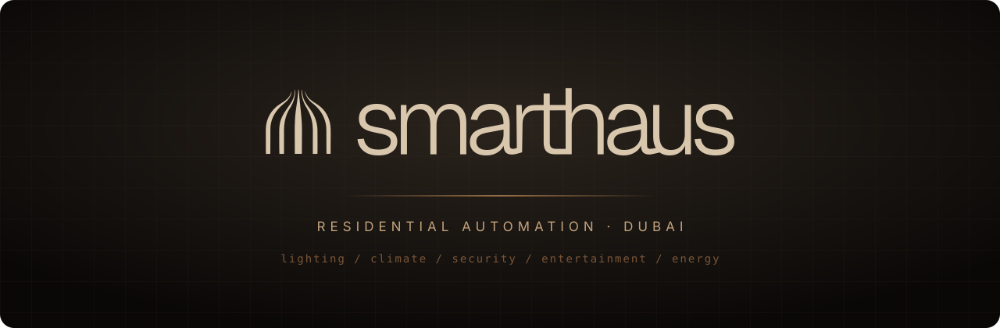
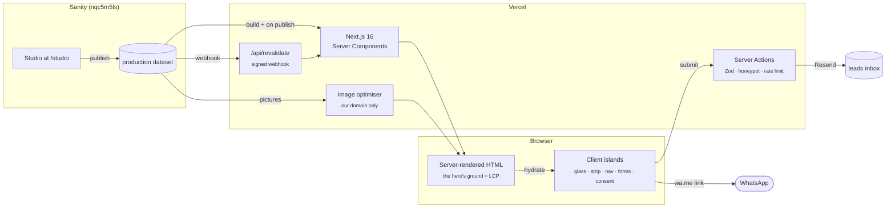

<p align="center">
  
</p>

<p align="center">
  <a href="https://smarthaus.ae"></a>
  
  
  
  
  
  
</p>

<p align="center">
  <b>The marketing site for Smarthaus</b>, the home automation brand of Maple Technologies.<br>
  Every page ends at one conversion: a conversation.
</p>

<p align="center">
  <a href="#-quickstart">Quickstart</a> ·
  <a href="#-architecture">Architecture</a> ·
  <a href="#-content">Content</a> ·
  <a href="#-the-hero">The hero</a> ·
  <a href="#-quality-gates">Quality gates</a> ·
  <a href="#-commands">Commands</a> ·
  <a href="#-where-the-rules-live">Rules</a>
</p>

---

## ◆ At a glance

```text
 ┌──────────────────────────────────────────────────────────────────────┐
 │  SMARTHAUS / smarthaus.ae                                            │
 ├──────────────────────────────────────────────────────────────────────┤
 │  kind        marketing site: no app, no dashboard, no e-commerce     │
 │  rendering   Server Components first, a short list of client islands │
 │  content     Sanity, every page; the Studio at /studio               │
 │  hero        reeded glass in raw WebGL2 over a server-painted ground │
 │  motion      CSS + IntersectionObserver + Web Animations API         │
 │  leads       Server Action → Zod → honeypot → rate limit → Resend    │
 │  analytics   Vercel, cookieless; GA4 and Clarity off until their ids │
 │  runtime     12 production dependencies, total                       │
 │  host        Vercel, production from main, preview per PR            │
 └──────────────────────────────────────────────────────────────────────┘
```

It is built for four readers, and none of them respond to hype: an existing Maple client who wants the spec, a couple comparing five vendors who fear the one that disappears, an investor who wants numbers, and an interior designer who needs something she can hand to her own client. The code is held to the same standard as the copy: precise, restrained, verifiable.

---

## ⚡ Quickstart

> Requires **Node 22** and **pnpm 12** (pinned in `packageManager`). The Sanity CLI needs Node 22.12 or later.

```bash
git clone --recurse-submodules https://github.com/Qera-Studio/smarthaus.git
cd smarthaus
pnpm install
cp .env.example .env.local   # fill in the values below
pnpm dev                     # http://localhost:3000
```

Cloned without submodules? `git submodule update --init` pulls in `qera-system/`.

<details>
<summary><b>Environment variables</b></summary>
<br>

| Variable                        | Scope  | Purpose                                                                       |
| ------------------------------- | ------ | ----------------------------------------------------------------------------- |
| `NEXT_PUBLIC_SITE_URL`          | public | Canonical origin for metadata, OG and the sitemap                             |
| `NEXT_PUBLIC_SANITY_PROJECT_ID` | public | The Sanity project                                                            |
| `NEXT_PUBLIC_SANITY_DATASET`    | public | `production` on the site; `ci` in CI and e2e, a copy of the seed              |
| `SANITY_REVALIDATE_SECRET`      | server | Signs the publish webhook that refreshes pages                                |
| `SANITY_API_TOKEN`              | server | A Viewer token for draft preview; never write access                          |
| `RESEND_API_KEY`                | server | Sends lead emails                                                             |
| `LEAD_EMAIL`                    | server | The mailbox that receives leads (the system of record)                        |
| `LEAD_FROM_EMAIL`               | server | Sender address, on a domain verified in Resend                                |
| `NEXT_PUBLIC_CLARITY_ID`        | public | Microsoft Clarity. Unset, it never loads. Read AGENTS.md "Analytics" first    |
| `NEXT_PUBLIC_GA_ID`             | public | Google Analytics 4, after an accept only. Unset, it never loads. Same warning |

`VERCEL`, `VERCEL_ENV` and `VERCEL_URL` are injected by the platform. Vercel Analytics and Speed Insights mount only when `VERCEL` is set, because their scripts are served by Vercel, not by this app. `src/lib/runtime-config.ts` reports any variable missing in production.

</details>

---

## 🏛 Architecture



**The shape of the thing:**

- **Server first.** Every page is a Server Component. `'use client'` is a short, named list in [`CLAUDE.md`](CLAUDE.md#client-components--the-short-list), and each entry earns its place.
- **No database.** A lead is an email. When a CRM exists, that changes. Not before.
- **No third party on first load.** No pixel, no chat widget, no tag manager. Sanity's pictures reach visitors through Next's image optimiser on our own domain, so the browser never talks to Sanity. GA4 and Clarity are wired behind the consent banner and switched off: each loads only when its id is set.
- **CSP is `default-src 'self'`.** The widenings are `'wasm-unsafe-eval'` and a `blob:` worker for the self-hosted Draco decoder, and `'unsafe-inline'`, an accepted risk; each is reasoned inline in [`next.config.ts`](next.config.ts). A stricter report-only twin, without `'unsafe-inline'`, runs alongside it, and both report to `/api/csp-report`. `/studio` and draft preview get a policy of their own that lets the Studio reach Sanity.

---

## ✍️ Content

Every page's copy, pictures and search metadata live in Sanity, and so do the contact details, the footer, the legal pages and the consent wording. Editors change the site in the Studio; publishing refreshes it within seconds through the signed webhook, and a draft can be previewed in place first. Layout, behaviour, the primary nav and what must work without Sanity (the error pages, the form's validation) stay in code.

- **One read path.** `src/sanity/fetch.ts` fetches one document at build, cached under one tag; `src/sanity/content.ts` has a getter per document. A missing document fails the build rather than render an empty page.
- **The schema enforces the rules.** Structured fields only, no page builder. The claims audit (`src/sanity/claims.ts`) refuses tiers, awards, superlatives, exclamation marks and em dashes at publish; search metadata is checked against the SEO System's lengths.
- **The seed** (`sanity/seed/`) is the content as first migrated: the `ci` dataset, the unit tests' content, and the record. Production was seeded once and is the Studio's now: never import the seed into it again.
- **The privacy policy is checked against the code.** `scripts/legal-accuracy.mjs` runs before every build and fails it if a processor the code installs is missing from the published policy.

Details in [`AGENTS.md`](AGENTS.md#cms--sanity).

---

## 🎬 The hero

The homepage opens on a dark pane of reeded glass with a blurred ring of light behind it, a title, an email field that books a site visit, and a strip of pictures that drifts and glides with the page's scroll.

```text
   first paint                         after the page is interactive
 ┌──────────────────────┐            ┌──────────────────────┐
 │  ground.webp (3KB)   │            │  WebGL2 glass        │   one frame, then frames
 │  + CSS reed lines    │  ──fade──▶ │  refracts the ground │   only while a mouse moves
 │  = LCP, preloaded    │            │  + a glow under mouse│   or the glow fades
 └──────────────────────┘            └──────────────────────┘
          ▲
          └── stays on: reduced motion (glass drawn still, no glow) · Save-Data · any WebGL failure
```

The glass is `src/components/HomeHero/GlassCanvas.tsx`, raw WebGL2 with no dependency, dynamically imported, and capped in brightness so the text over it keeps its contrast. The ground is baked by `scripts/bake-glass-ground.mjs`. It is the third and last canvas exception to the motion stack; the reasoning and its conditions are in [`CLAUDE.md`](CLAUDE.md#the-third-exception-the-heros-glass).

The three.js villa that came before it, and the fluid hero after that, are unmounted, not deleted (`src/components/Hero/`), so the villa can return.

<details>
<summary><b>The Process stack</b></summary>
<br>

Six full-screen sheets, each `position: sticky` at the top of the screen, so the next rises from the bottom and covers the last as you scroll. The hardware section before them holds still while the first sheet rises over it and snaps to full width. No timeline and no scroll listener. Every sheet is one screen tall, and the stack turns into plain sections under reduced motion or on a short screen. Details in [`AGENTS.md`](AGENTS.md#the-process-stack--sheets-on-scroll).

</details>

---

## 🛡 Quality gates

Nothing merges into `latest` or `main` on trust. Every check below is a required status in CI, enforced by the `protect latest and main` ruleset.

| Job                    | What it proves                                                                              |
| ---------------------- | ------------------------------------------------------------------------------------------- |
| `static`               | ESLint, `tsc`, a production build, and the cascade layer order in **every** built CSS chunk |
| `unit`                 | Jest + RTL with coverage, the coverage gate, and the 1:3 test-ratio gate                    |
| `e2e (Desktop Chrome)` | Playwright + axe on every route                                                             |
| `e2e (iPhone 17)`      | Same suite, WebKit, 402 px mobile viewport                                                  |
| `e2e (Galaxy S24)`     | Same suite, Chromium, 360 px narrow Android viewport                                        |
| `e2e-extra`            | `forced-colors` and 200% zoom projects                                                      |
| `lighthouse`           | Lighthouse CI against the production build, `/`, `/pricing` and `/contact`, mobile          |

One more job runs on every PR but is deliberately not required: `delivery` sends one real email through Resend, so a broken key, domain or quota shows up without blocking code that did not cause it.

**Lighthouse thresholds** live in [`lighthouserc.json`](lighthouserc.json) and nowhere else. Accessibility and SEO must score 1.00. The performance score and blocking time are warnings, not errors, until Phase 5b, an accepted risk with the measurements in `docs/launch-gate/accepted-risks.md`. Runs are measured, not simulated, and calibrated so every machine emulates one target phone.

**Test discipline.** Every line of code carries three lines of test. Until the tree reaches 3:1, each PR must meet 3:1 on its own diff and must not lower the overall ratio. Every line a PR adds or changes must run in a unit test, with at least 90% of the branches on those lines taken, and global line coverage may only go up. Unit tests fail on any `console.error`/`warn`, and on any CSS Module key that does not exist. A failing test is reported, never retried, skipped or softened.

> [!NOTE]
> Honest status: the tree is still below 3 : 1 and ratcheting up (it started at 0.44 : 1). `pnpm test:ratio` prints the current figure and the shortfall.

Locally, Husky runs lint, Prettier and `tsc` on commit, and the full unit suite plus both gates on push.

---

## 🧰 Commands

| Command               | Does                                                                     |
| --------------------- | ------------------------------------------------------------------------ |
| `pnpm dev`            | Dev server (Turbopack)                                                   |
| `pnpm build`          | The privacy-policy accuracy gate, then a production build                |
| `pnpm start`          | Serve the production build                                               |
| `pnpm lint`           | `eslint .` (`next lint` no longer exists in Next 16)                     |
| `pnpm typecheck`      | `tsc --noEmit`                                                           |
| `pnpm test`           | Jest unit suite                                                          |
| `pnpm test:coverage`  | Jest with coverage                                                       |
| `pnpm test:e2e`       | Playwright across all device projects                                    |
| `pnpm test:lhci`      | Calibrated Lighthouse CI against a local production build                |
| `pnpm test:ratio`     | Measure the code-to-test line ratio                                      |
| `pnpm coverage:gate`  | Check coverage against the baseline and touched files                    |
| `pnpm coverage:raise` | Raise `coverage-baseline.json` after adding tests (only goes up)         |
| `pnpm sanity:seed`    | Write the seed to `sanity/seed/out/` for importing into the `ci` dataset |
| `pnpm analyze`        | Bundle analyzer                                                          |

> [!IMPORTANT]
> E2E form tests do not send email. Under Playwright the server writes each lead email to `.e2e-mail/`, and the tests read it back to check its content, consent record included. One test per CI run, in the `delivery` job, sends a real email through Resend.

---

## 🗺 Project layout

```text
smarthaus/
├── src/
│   ├── app/              routes · metadata · robots · sitemap · Server Actions · /api · the Studio
│   ├── components/       one folder per component, each with its module.scss and __tests__
│   ├── sanity/           schema · the read path · localize · the claims audit · Studio config
│   ├── content/          what stays in code: the scene manifest, metadata routes' data
│   ├── lib/              Zod schemas, consent record, analytics loaders, helpers
│   └── styles/           tokens, reset, cascade layers
├── sanity/seed/          the content as migrated: the ci dataset and the tests' content
├── public/
│   ├── hero/             the glass ground, the strip, hardware and process imagery
│   ├── solutions/        the solution pages' pictures and process drawings
│   ├── draco/            self-hosted decoder for the unmounted villa
│   └── brand/            logo lockups, all currentColor SVG
├── e2e/                  Playwright specs, one per surface
├── scripts/              ratio + coverage gates, legal accuracy, layer order, Lighthouse, bakes
├── docs/                 the launch gate's records and the runbooks
├── qera-system/          ⟵ submodule: the standards this repo answers to (read-only here)
├── AGENTS.md             engineering rules: how
└── CLAUDE.md             project orientation: who, what, why
```

**Routes.** `/`, `/about`, `/contact`, `/pricing`, `/faq`, `/blog` and one page per article, eight solution pages at `/solutions/<id>`, `/privacy`, `/terms`, `/accessibility`, `/cookie-preferences`, `/studio`, and a `/404` with a particle-text canvas. Placeholders until their content is written: `/solutions`, `/designers`, `/developers`. A page with "Show in search" off in the Studio is `noindex` and out of the sitemap.

---

## 📐 Where the rules live

This repo answers to [`qera-system/`](qera-system/), nine documents with a fixed precedence:

```text
 1 Legal  ▸  2 Security  ▸  3 Accessibility  ▸  4 Engineering  ▸  5 Performance  ▸  6 SEO  ▸  7 Design
```

When two rules disagree, the lower number wins. Before writing any threshold into this repo, check `qera-system/charter/owned-facts-register.md`: if another document owns the number, point to it, don't copy it.

| Read                                                                           | For                                                                                               |
| ------------------------------------------------------------------------------ | ------------------------------------------------------------------------------------------------- |
| [`CLAUDE.md`](CLAUDE.md)                                                       | Who Smarthaus is, the four personas, tone, visual direction, the client-island list               |
| [`AGENTS.md`](AGENTS.md)                                                       | CMS, CSP, forms, analytics, the claims audit, dependency policy, testing policy                   |
| [`docs/launch-gate/pre-launch-fixes.md`](docs/launch-gate/pre-launch-fixes.md) | The work left before launch; decisions in `accepted-risks.md`, questions in `blocked-on-input.md` |

**Five rules that surprise people:**

1. **No GSAP, Framer Motion, Lenis, or React Three Fiber.** Three canvas exceptions exist, each argued in CLAUDE.md; there will not be a fourth.
2. **Logical properties only.** `padding-inline`, never `padding-left`. Arabic is V2, and RTL should cost an afternoon, not a rewrite.
3. **No `var()` inside CSS shorthands.** One missing token silently kills the whole declaration.
4. **No claim without a source.** No invented heritage, no unconfirmed partner logos, no founding year until there is one. The Studio refuses the rest.
5. **No stock photos of smart homes, in the long run.** The stock on the site today is marked temporary in the Studio, and tests fail once the last mark is cleared.

---

## 🌿 Workflow

```text
 version/2.0.0  ──PR──▶  latest  ──PR──▶  main  ──▶  Vercel production
                           ▲                ▲
                  all CI checks    all CI checks
```

Three branches, no others. Everything not yet live on `main` is committed to `version/2.0.0`. Commits are imperative, lowercase, and explain **why**.

### Runbooks

When something needs doing by hand, or has gone wrong:

| Situation                                | Runbook                                                           |
| ---------------------------------------- | ----------------------------------------------------------------- |
| Shipping, or undoing a bad release       | [Deploy and roll back](docs/runbooks/deploy-and-rollback.md)      |
| A lead did not arrive                    | [Lead delivery failure](docs/runbooks/lead-delivery-failure.md)   |
| The Resend key may be exposed, or is due | [Rotate the Resend key](docs/runbooks/rotate-resend-key.md)       |
| The banner asks for something new        | [Bump the consent version](docs/runbooks/consent-version-bump.md) |
| A new page                               | [Add a route](docs/runbooks/adding-a-route.md)                    |
| The shared rate limit in Vercel          | [Vercel Firewall](docs/runbooks/vercel-firewall.md)               |
| A dependency is compromised              | [Compromised dependency](docs/runbooks/compromised-dependency.md) |

<br>

<p align="center">
  <sub>Built by <b>Qera Studio</b> for <b>Maple Technologies</b> · Dubai</sub>
</p>
